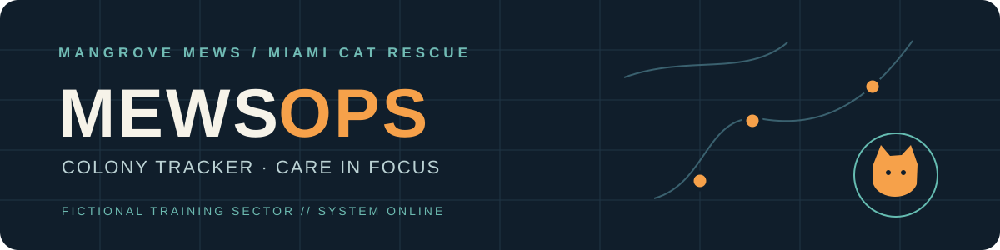
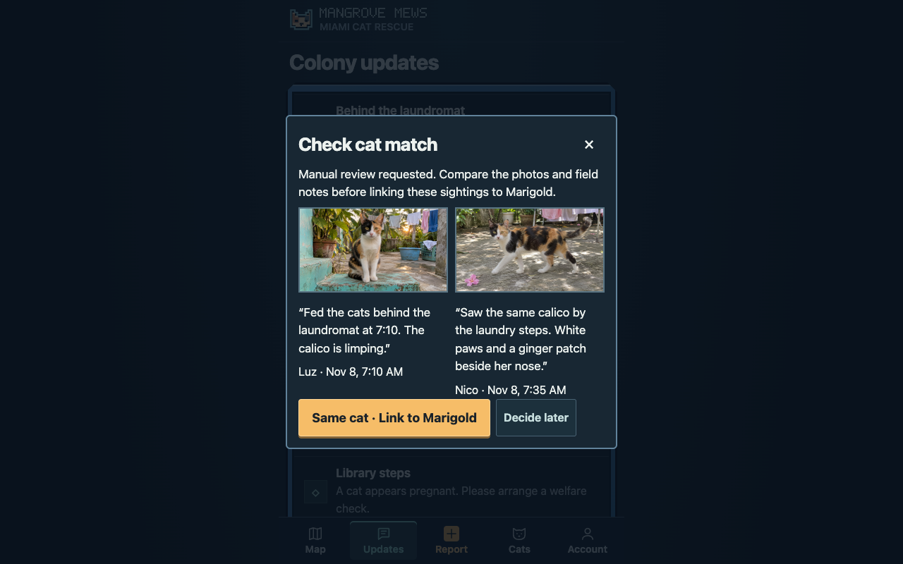

<p align="center"></p>

<p align="center"><strong>A clearer picture of every colony, every day.</strong><br>Turn fictional field reports into a shared, human-reviewed cat colony tracker.</p>

<h3 align="center"><a href="https://mewsops-cat-tracker.vercel.app">🐾 Open the live demo</a></h3>

<p align="center"><code>CODEX</code> · <code>OPENAI AGENTS SDK</code> · <code>VERCEL</code> · <code>FICTIONAL DATA</code></p>

---

## 01 / Enter the tracker

Open the [live tracker](https://mewsops-cat-tracker.vercel.app) on a phone or computer. Choose a fictional team member and enter their demo code:

| Team member | Role | Demo code |
| --- | --- | --- |
| Luz | Feeder | `F06DDADF8F8E` |
| Nico | Volunteer | `709AFB4ED19C` |
| Beatriz | Founder | `3CCA11F5FD0F` |

> **Demo data only.** These accounts are public and share the same fictional dataset. Anyone with the codes can change the demo. Never enter real rescue information.

## 02 / Follow a report

1. As **Luz**, open **Report**, choose **Use feeding + limp sample**, and send the note, fictional location and photo.
2. As **Nico**, send **Use second sighting** with another synthetic photo.
3. As **Beatriz**, open Nico’s update, compare the two sightings and confirm the match to **Marigold**.
4. Return to Laundry Lane’s colony details: the census stays at **7 cats**, and the injury alert remains open for follow-up.



## 03 / The mission

Small rescue teams juggle updates across messages, photos, notebooks and spreadsheets. Urgent cases can get buried, and different volunteers can report the same cat twice. MewsOps brings those reports together so the rescue can see what each colony needs.

Mangrove Mews is a fictional rescue created for the Codex Hackathon for Miami’s Non-Profits. Its challenge reflects real problems shared by South Florida nonprofits.

## 04 / What the tracker does

- **Colony overview:** See confirmed cats, fixed and awaiting-TNR counts, veterinary concerns and the last feeding visit.
- **Field reporting:** Send a note, photo and deliberately shared fictional location from a phone browser.
- **Human review:** Compare evidence and confirm cat identity before sightings are linked.
- **Care alerts:** Surface reported injury, pregnancy, kittens and feeder coverage concerns.
- **Shared workspace:** Separate fictional accounts access reports through the same hosted tracker.

## 05 / How it works

The web interface talks to a Node.js API backed by a shared Turso database and private Vercel Blob storage. The OpenAI Agents SDK can analyze submitted evidence when a valid API key is configured. Reports remain available for manual review if analysis is unavailable or fails. Codex supported development and integration.

The demo uses fictional locations and deliberately submitted reports. It does not pull messages from live WhatsApp chats. Shared public demo codes are for this synthetic demonstration, not a production rescue deployment.

## 06 / Run locally

Use Node.js 24 or 26, then install the locked dependencies and start a fresh connected demo:

```sh
npm ci
npm ci --prefix src/api
npm run tracker -- --lan --fresh
```

Keep the terminal running and open the printed URL. The terminal supplies temporary codes for each fictional user. Add an `OPENAI_API_KEY` to the laptop environment or an ignored `.env.local` file to enable live analysis; without a working key, reports remain available for manual review. See the [recording walkthrough](mobile/README.md#record-the-demo) for more details.

---

<p align="center"><strong>MANGROVE MEWS / COLONY TRACKER</strong><br><sub>Built for the Codex Hackathon for Miami’s Non-Profits</sub></p>
